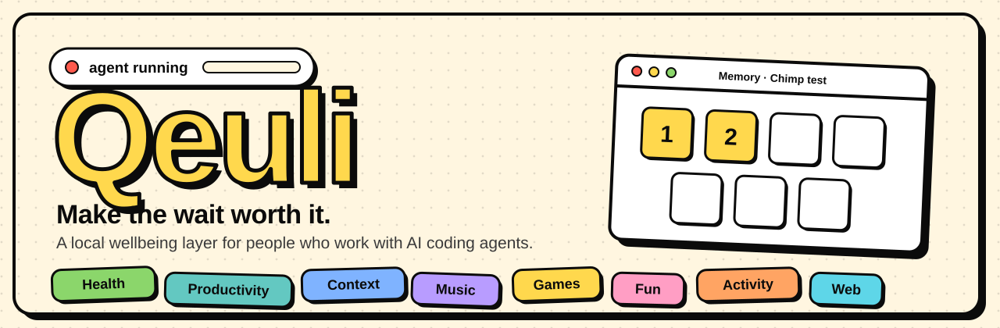

<div align="center">



<br/>

[](LICENSE)
[](package.json)
[](#download)
[](#privacy)

**A local wellbeing layer for developers who work with AI coding agents.**<br/>
While your agent thinks, Qeuli looks after you, and gives that time back.

### [⬇ Download Qeuli for Windows](https://github.com/Qeuli-AI/Qeuli/releases/latest/download/Qeuli-Setup.exe)

[All releases](https://github.com/Qeuli-AI/Qeuli/releases) · [Website](https://qeuli-ai.github.io/Qeuli/) · [What it does](#what-it-does) · [Privacy](#privacy) · [Contribute](CONTRIBUTING.md)

</div>

---

## Why

Claude Code, Codex, a training run, a long build: you hit enter and then you wait. Thirty seconds here,
ten minutes there. It adds up to hours a week, usually spent doomscrolling or just sitting.

Qeuli notices when a run starts and offers something better for exactly that long: drink some water,
rest your eyes, park the idea you just had, stretch, read something you saved. When the agent finishes,
you are told. Nothing is hosted, nothing leaves your machine.

```
Claude Code hooks ─┐
Codex notify  ─────┤
qeuli run -- … ────┼─► local daemon (127.0.0.1:47821) ─┬─► Desktop app (Tauri: tray, window)
process watches ───┘                                   ├─► MCP server (an agent can call it)
                                                       └─► Chrome extension (side panel)
```

## Download

**[Qeuli-Setup.exe](https://github.com/Qeuli-AI/Qeuli/releases/latest/download/Qeuli-Setup.exe)**, the
Windows installer, from the [latest release](https://github.com/Qeuli-AI/Qeuli/releases/latest) (about
24 MB; the daemon, a Node runtime and the UI are inside). Run it, then open Qeuli from the Start menu. It
lives in the tray and starts with Windows.

The installer is not code-signed yet, so Windows SmartScreen may say "unknown publisher": choose
**More info → Run anyway**. Each release lists a SHA-256 checksum next to the file.

To hook up Claude Code, run `qeuli install claude` once (see [Install](#install-the-cli)).

## What it does

Eight divisions, each with its own colour on the Home screen. Every feature is its own folder.

| | Feature | What you get |
| --- | --- | --- |
| **Health** | [Water](water/README.md) | A goal from your weight, vessels (cup, glass, bottle), a per-day chart, reminders, a nudge when a run starts |
| | Breaks | Eye rest (20-20-20), stretch, walk, breathe: guided and animated, with a daily goal and a streak |
| **Productivity** | Parking lot | Park ideas, draft your next prompt, jot to-dos while the agent works |
| | Waiting report | How long you wait on agents, the trend against last week, and what that time could have bought |
| **Context** | Context | A live feed of what the agent is doing, and a plain-English recap of its last run |
| **Music** | Soundscapes | Tide, rain, focus, lo-fi, night garden, made live with Web Audio; can follow your agent |
| **Games** | Quick games | A few short ones, sized for a wait, with scores kept per setting |
| **Fun** | Small delights | A dev joke, a daily riddle with a streak, ask the hawk, coin and dice |
| **Activity** | Desk workouts | Guided no-equipment routines, a daily minutes goal and a streak |
| **Web** | Feed and reading queue | Hacker News into a queue of reads; one is offered when its length fits your wait |

**Your story.** First run asks for a font and style, then who you are: a name, a sigil, a role, a quest,
a vibe and a one-line origin. Qeuli writes you a prologue. Healthy habits earn XP across every division,
and levels unlock chapters. It is all templates, written locally.

**Looks.** Two styles (**Sticker**: thick outlines, hard shadows; **Calm**: hairlines and soft corners),
four font packs, 14 colour schemes, and *Match my Cursor / VS Code theme*, which reads installed editor
themes from disk.

## Roadmap

What is next, not a promise of dates.

- [x] Local daemon, desktop app, Claude Code and Codex hooks
- [x] Waiting report
- [x] Renamed from AgentWell to Qeuli (command, data folder, docs)
- [x] One-click release pipeline that publishes the Windows installer
- [ ] Code-signed installer
- [ ] macOS and Linux builds

Want one of these? [Pick it up](CONTRIBUTING.md). History is in the [changelog](CHANGELOG.md).

## Install the CLI

The desktop app installs from the [download](#download) above. To work from source, or to use only the CLI
and daemon:

```bash
npm install
node src/cli.js install claude     # adds hooks to ~/.claude/settings.json
node src/cli.js install codex      # prints the line to add to ~/.codex/config.toml
```

The daemon starts by itself the first time a hook fires. To run it by hand: `node src/cli.js daemon`.

MCP, so an agent can ask Qeuli for something to do while you wait:

```bash
claude mcp add qeuli -- node /path/to/Qeuli/src/cli.js mcp
```

> **Coming from AgentWell?** Qeuli was first called AgentWell. If you already have a `~/.agentwell`
> folder it keeps being used, so your data stays put; new installs use `~/.qeuli`. Re-run
> `qeuli install claude` once to point your hooks at the new name (old hooks are replaced, not duplicated).

### Try the UI in a browser

```bash
cd desktop
npm run preview            # then open the printed address
```

This runs its own daemon on its own port with its own data folder and its own copy of the Claude Code
settings file, so it cannot touch an installed app or your real hooks. Edit any UI file and refresh.
`--reset` starts empty and `--quiet` mutes toasts.

## How it works

Agents tell Qeuli when they start and stop; Qeuli decides what to do with the gap.

| Source | How it connects |
| --- | --- |
| Claude Code | Hooks written to `~/.claude/settings.json` by `qeuli install claude` |
| Codex | A `notify` line in `~/.codex/config.toml` |
| Any command | `qeuli run -- <cmd>` treats it as an agent run |
| An existing process | `qeuli watch <pid>` or `qeuli watch --match <text>` |
| Things that start by themselves | Auto-watch rules, below |

### Command line

| Command | What it does |
| --- | --- |
| `status` | Agent sessions and today's wait time |
| `suggest [minutes]` | A queued read or a break that fits the wait |
| `queue add <url> [title] [minutes]` | Save a read |
| `run -- <cmd>` | Treat any command as an agent run |
| `watch <pid> [--name n]` | Track an existing process until it exits |
| `watch --match <text> [--name n]` | Track any process whose command line contains the text |
| `feature [install\|remove\|enable\|disable]` | List or manage features |
| `drink [ml]`, `break [kind]`, `park "text"` | Commands the features declare in their `feature.json` |

### Auto-watch

```bash
qeuli config add --match train.py --name "Model training" --exe python
qeuli config add --match ffmpeg --name "Video encode" --exe ffmpeg
```

The daemon then notices these starting and finishing by itself. Edit `~/.qeuli/config.json` for
`scanSeconds` (default 10), `minSeconds` (a run must last this long to count, default 15) and
`graceSeconds` (how long it may vanish between epochs, default 10). Setting `--exe` keeps it cheap on
Windows: only a `tasklist` image check runs until that executable exists.

```bash
qeuli progress 40 --message "epoch 4/10"            # if exactly one session is running
qeuli progress 40 --session watch-model-training
```

### MCP tools

`suggest_for_wait`, `queue_reading`, `log_learning`, `session_status`

## Privacy

Everything runs on your machine.

- **Context keeps labels, not contents.** Only tool names and short labels (a file's base name, a
  command's first word, a website). Never file contents, full paths, full commands or prompts.
- **The Feed is the only network call.** It fetches `hacker-news.firebaseio.com` from your machine and
  sends nothing about you.
- **Your data is one file.** `~/.qeuli/data.json`, written atomically with a rolling backup.
- **Websites cannot reach the daemon.** It binds to loopback only and rejects any request whose Origin is
  not the CLI or the app.

## Features are folders

Each feature is a top-level folder next to `src/`. The core knows nothing about what a feature does; it
finds the folder by its `feature.json` and hands it a few hooks.

```
<name>/
  feature.json    id, name, description, division, defaultEnabled, optional tray and cli entries
  index.js        backend:  export default { setup(ctx) }  returning { routes, tick, onEvent }
  ui/index.js     frontend: export function mount(ctx)    adds a screen
  *.test.js       tests, picked up by npm test
```

Create the folder, run `npm run features`, and it appears in the app. The full contract and a walk-through are in [CONTRIBUTING.md](CONTRIBUTING.md#add-a-feature).

**Add-ons without code.** A folder with just a `feature.json` that declares reminders (see
[`examples/stretch`](examples/stretch)) installs with `qeuli feature install ./folder`. It copies only
the validated manifest, so installing one cannot run anything on your machine.

## Contributing

Bug reports, new features and new reminders are welcome. Start with
[CONTRIBUTING.md](CONTRIBUTING.md); it covers setup, the test command, the feature contract and what
makes a good pull request.

## License

[MIT](LICENSE) © 2026 Naman Omar
